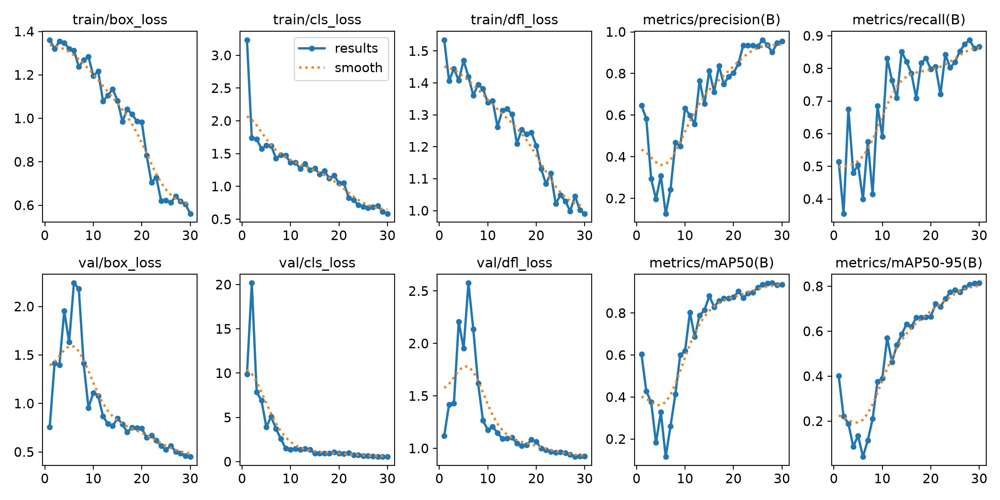
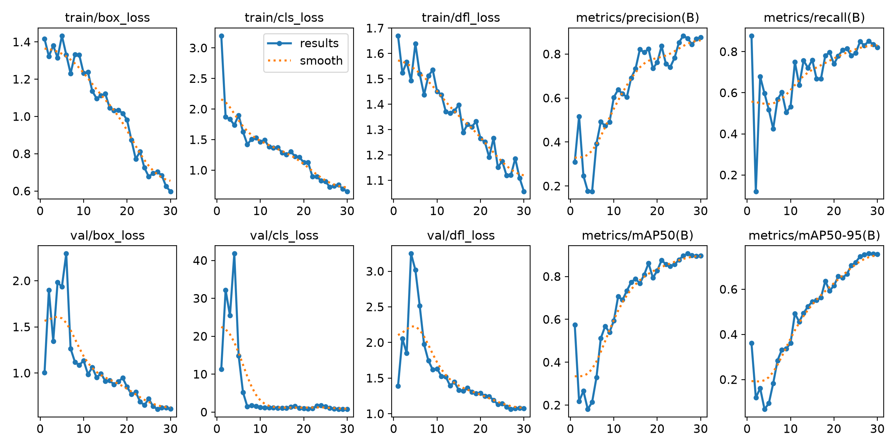
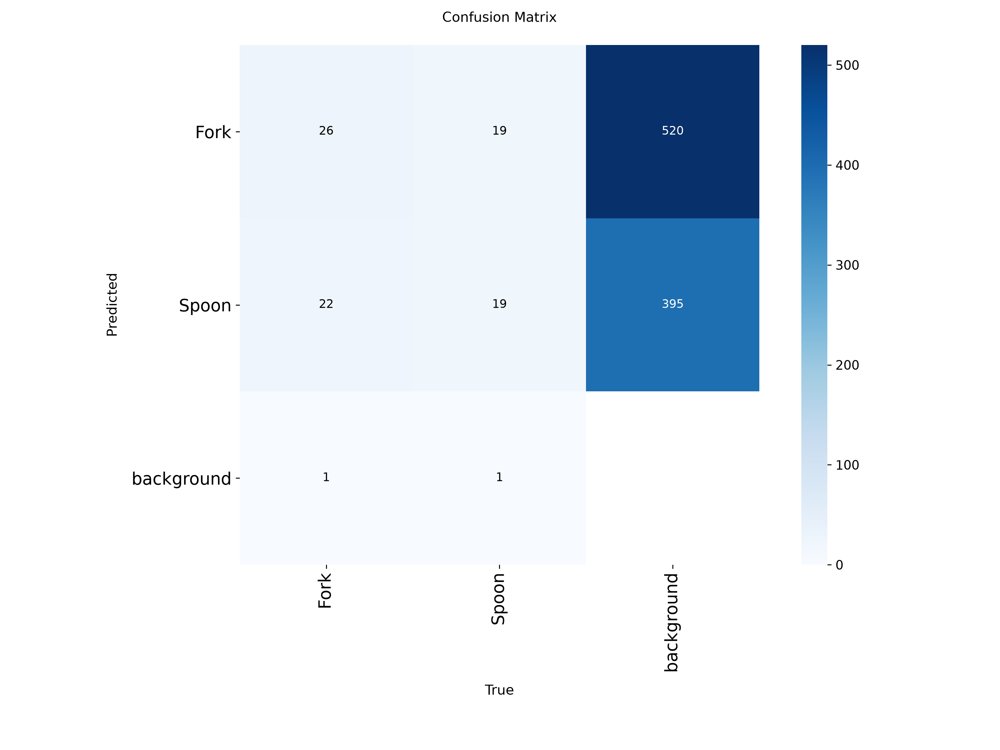
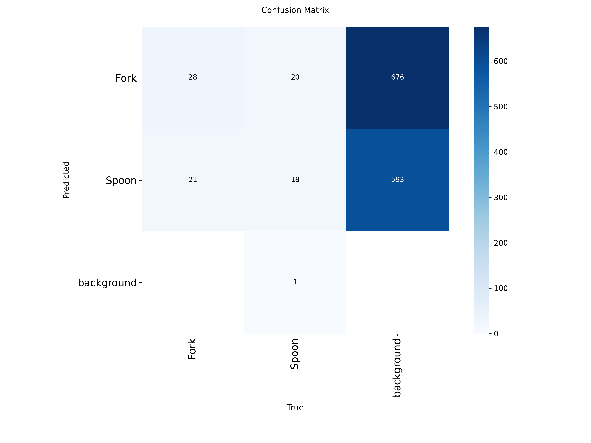

# Deteksi Sendok dan Garpu dengan YOLOv8

Praktik RET503 Computer Vision and Deep Learning.
Nama: Rahel Evanggelisa Mahanaim S | NIM: 4222401022

Proyek ini melatih detektor objek YOLOv8 untuk dua kelas, **Fork** dan **Spoon**, memakai dataset foto sendiri. Tiga eksperimen dibandingkan: transfer learning (E1), pelatihan dari nol (E2), dan satu percobaan tuning (E3).

## 1. Dataset

Dataset dibuat sendiri dengan alur berikut:

1. **Pengumpulan foto.** Foto sendok dan garpu dikumpulkan di `dataset_raw` (satu folder per kelas, tanpa label).
2. **Pembersihan dan penggabungan.** Foto dibersihkan dan digabung dengan `gabung.py` menjadi `dataset_bersih`.
3. **Anotasi dan pembagian dengan Roboflow.** Foto diunggah ke Roboflow, tiap objek diberi bounding box untuk kelas `Fork` dan `Spoon`, lalu dataset dibagi menjadi train, valid, dan test di Roboflow. Hasilnya diekspor dalam format **YOLOv8** (`dataset_v1`: `train/`, `valid/`, `test/`, masing-masing berisi `images/` dan `labels/`, ditambah `data.yaml`). Roboflow dipakai sebagai pengganti tahap konversi format dan pembagian dataset secara manual.

Jumlah data (dihitung dari folder `dataset_v1`):

| Split | Gambar | Fork | Spoon | Total kotak |
|---|---|---|---|---|
| Train | 195 | 184 | 175 | 359 |
| Valid | 65 | 49 | 39 | 88 |
| Test | 35 | 40 | 30 | 70 |
| Total | 295 | 273 | 244 | 517 |

- Keseimbangan kelas baik (Fork 53%, Spoon 47%), sehingga tidak ada kelas yang mendominasi. Rincian ada di `class_balance.csv` (angka di berkas itu adalah jumlah kotak, bukan jumlah gambar).
- Pengecekan data: jumlah gambar sama dengan jumlah label di tiap split, tidak ada label kosong, tidak ada nama file yang sama antar split, dan semua nilai label berada dalam rentang 0-1.
- Augmentasi di Roboflow: tidak ada (Versions: *Augmentations: None added to this version*), sehingga seluruh gambar di `dataset_v1` adalah foto asli. Ultralytics tetap menerapkan augmentasi bawaannya saat training.

## 2. Pengaturan Eksperimen

Semua eksperimen memakai pengaturan yang sama kecuali yang tertulis di kolom perubahan: model `yolov8n`, 30 epoch, batch 16, seed 0. Pelatihan dan evaluasi dijalankan di CPU (tanpa GPU).

| Kode | Deskripsi | Perubahan |
|---|---|---|
| E1 | Pretrained COCO (transfer learning), imgsz 416 | baseline |
| E2 | Arsitektur sama, bobot acak (tanpa transfer learning), imgsz 416 | tanpa pretrained |
| E3 | E1 dengan satu perubahan | imgsz 416 menjadi 640 |

Model terbaik dipilih berdasarkan mAP50-95 pada data valid, lalu diuji satu kali pada data test.

## 3. Hasil

Evaluasi pada data valid:

| Eksperimen | mAP50 | mAP50-95 | Precision | Recall | Inferensi (ms/gambar) | Waktu latih (menit) |
|---|---|---|---|---|---|---|
| E1 pretrained | 0.936 | 0.814 | 0.955 | 0.867 | 38.2 | 19.5 |
| E2 scratch | 0.305 | 0.129 | 0.276 | 0.407 | 43.3 | 21.2 |
| E3 tuning (imgsz=640) | 0.900 | 0.758 | 0.852 | 0.852 | 215.7 | 40.6 |

Model terpilih: **E1 pretrained** (mAP50-95 valid tertinggi).

Hasil pada data test (satu kali): **mAP50 0.911 | mAP50-95 0.790**.

Grafik pelatihan:

| E1 pretrained | E3 tuning |
|---|---|
|  |  |

Confusion matrix:

| E1 pretrained | E3 tuning |
|---|---|
|  |  |

## 4. Analisis

**E1 vs E2: manfaat transfer learning.** E1 mencapai mAP50-95 0.814, sedangkan E2 hanya 0.129, dengan precision dan recall E2 yang rendah (0.276 dan 0.407). Bobot pretrained COCO sudah mengenali bentuk dan tepi umum, dan COCO juga memuat kelas `fork` dan `spoon`, sehingga model cukup menyesuaikan diri dengan data baru. E2 harus mempelajari semuanya dari bobot acak, dan 195 gambar dengan 30 epoch tidak cukup. Pada dataset sekecil ini, transfer learning memberi selisih yang besar.

**E3: pengaruh ukuran input.** Menaikkan imgsz dari 416 ke 640 tidak membantu: mAP50-95 turun dari 0.814 ke 0.758, precision turun dari 0.955 ke 0.852, sementara waktu inferensi naik sekitar 5,6 kali (38,2 ke 215,7 ms) dan waktu latih sekitar 2 kali lipat. Penjelasan yang masuk akal adalah objek pada foto ini relatif besar (kotak sering memenuhi sebagian besar gambar), sehingga resolusi tambahan tidak memberi detail baru. Ini dugaan, bukan hasil yang diuji. Selisihnya juga diukur dari satu kali pelatihan (seed 0) pada data valid yang kecil (65 gambar, 88 kotak), jadi perbedaan kecil bisa saja berasal dari variasi. Keputusan: perubahan E3 **tidak dipakai**, E1 dipertahankan.

**Valid vs test.** mAP50-95 turun dari 0.814 (valid) ke 0.790 (test), dan mAP50 dari 0.936 ke 0.911. Selisihnya kecil dan searah, sehingga tidak ada tanda model terlalu menyesuaikan diri dengan data valid. Namun test hanya berisi 35 gambar (70 kotak), sehingga angkanya mudah bergeser dan sebaiknya dibaca sebagai perkiraan kasar.

**Precision dan recall.** Pada E1 precision (0.955) lebih tinggi dari recall (0.867): model jarang salah mendeteksi, tetapi masih melewatkan sebagian objek.

**Hasil per kelas (Fork vs Spoon).** [ISI setelah melihat `confusion_matrix.png` E1: kelas mana yang lebih sering salah, apakah Fork dan Spoon saling tertukar, dan apakah ada objek yang terlewat (dianggap background). Sebutkan angkanya dari gambar tersebut.]

## 5. Keterbatasan

- Dataset kecil (295 gambar) dan data test hanya 35 gambar.
- Setiap eksperimen hanya dijalankan satu kali (seed 0), tanpa pengulangan.
- Pelatihan dilakukan di CPU, sehingga waktu inferensi bukan ukuran kecepatan di GPU.
- Hanya satu perubahan yang diuji pada tahap tuning (ukuran input).

## 6. Cara Menjalankan Ulang

```
pip install ultralytics
py latih_banding.py --nim 4222401022 --nama "Rahel Evanggelisa" --model yolov8n
```

Ubah `path:` di `dataset_v1/data.yaml` sesuai lokasi dataset di komputer. Skrip menghasilkan `hasil_praktik_<NIM>.txt/.csv` dan folder `hasil_praktik/` berisi grafik tiap eksperimen.

## 7. Isi Folder

- `latih_banding.py`: skrip pelatihan dan evaluasi (E1, E2, E3)
- `gabung.py`: penggabungan foto fork dan spoon
- `class_balance.csv`: jumlah kotak per kelas dan per split
- `dataset_v1/`: dataset hasil ekspor Roboflow (format YOLOv8)
- `hasil_praktik_4222401022.txt` dan `.csv`: ringkasan hasil
- `hasil_praktik/`: grafik dan confusion matrix tiap eksperimen
- `README.md`: dokumen ini
